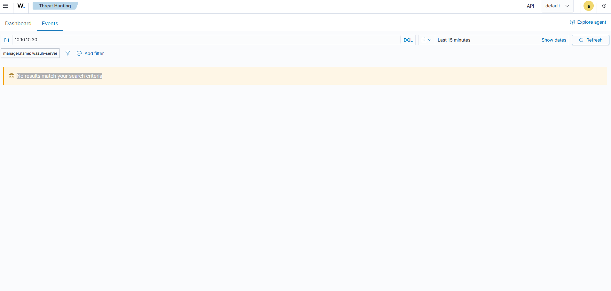
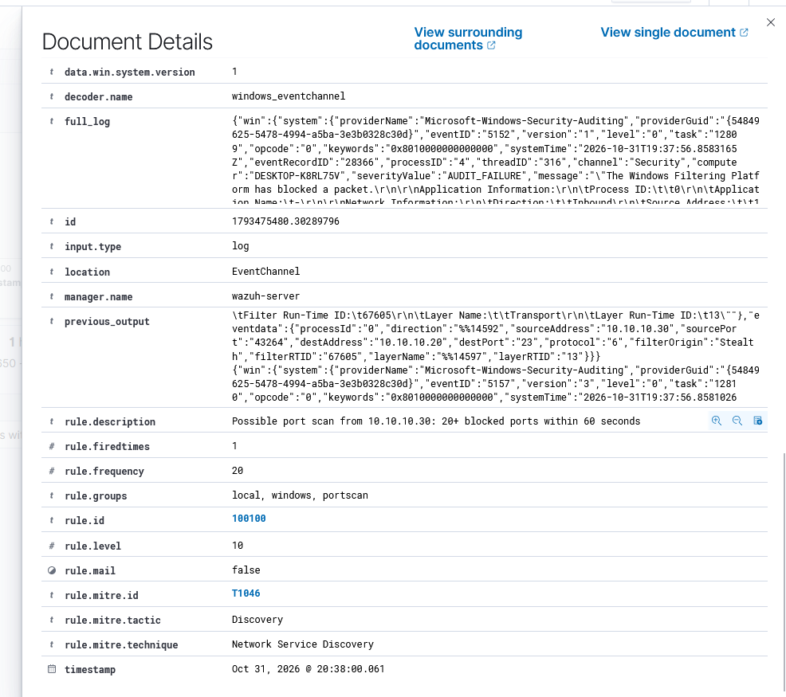

# Scenario 1 – Portskanning

MITRE ATT&CK: T1046 Network Service Discovery (Discovery)
Datum: 31 oktober 2026
Status: Klar

## Sammanfattning

Kali (10.10.10.30) portskannade Windows-maskinen (10.10.10.20) med Nmap. Från början var attacken helt osynlig. Efter felsökning hittades tre hinder mellan attacken och analytikern. När de var åtgärdade skrev jag en egen korrelationsregel som gör om tusentals brandväggshändelser till ett enda larm på nivå 10.

## Attack

```bash
sudo nmap -sS -T4 10.10.10.20 -oN nmap.txt
```

En SYN-skanning mot de 1 000 vanligaste portarna. Resultat:

```
Host is up (0.00038s latency).
Not shown: 1000 filtered tcp ports (no-response)
MAC Address: 00:0C:29:24:1A:F9 (VMware)
scanned in 21.26 seconds
```

Brandväggen blockerade alla portar, men angriparen fick ändå veta att maskinen fanns och att den var en VMware-maskin.

## Tidslinje

- 19:59:57 – Första skanningen startar.
- 20:08 – Ingen träff i Wazuh vid sökning på 10.10.10.30.
- 20:10 – Windows har inga brandväggshändelser (5152/5157): count 0.
- 20:12 – Loggning av blockerad trafik slås på med auditpol.
- 20:15 – Ny skanning. Windows loggar 2 252 händelser, men Wazuh visar fortfarande inget.
- 20:20 – Agentens filter ändras så att 5152 och 5157 skickas till servern.
- 20:23 – Ny skanning. En fältsökning i Wazuh hittar 2 188 händelser.
- 20:35 – Egen regel 100100 läggs till på servern.
- 20:38 – Ny skanning. Regeln larmar på nivå 10 inom sekunder.

## Felsökning

Loggarna passerar tre stationer på vägen, och alla tre stoppade attacken.

- Windows loggar inte blockerad trafik som standard. Löstes med auditpol, endast failure för att undvika brus.
- Wazuh-agenten filtrerar bort 5152 och 5157 i sin standardkonfiguration eftersom de ger mycket brus. Jag tog bort dem från filtret i ossec.conf.
- En fritextsökning på IP-adressen i Wazuh gav inga träffar fast händelserna fanns. En sökning på fält fungerade: `data.win.system.eventID: 5152 and data.win.eventdata.sourceAddress: 10.10.10.30`

```powershell
auditpol /set /subcategory:"Filtering Platform Packet Drop" /failure:enable
auditpol /set /subcategory:"Filtering Platform Connection" /failure:enable
```



## Egen detektionsregel

Wazuhs inbyggda regel 60104 gav ett larm per blockerat paket, alltså cirka 2 000 likadana larm som inte säger något om en skanning. Min regel larmar i stället när samma IP-adress får minst 20 paket blockerade mot olika portar inom 60 sekunder, och tystnar sedan i två minuter så att en skanning ger ett larm.

Regeln finns i [detections/100100-portscan.xml](../../detections/100100-portscan.xml).



## Lärdomar

Inga larm betyder inte att ingen attack har skett. Det gäller att veta vad som faktiskt loggas och hela vägen fram till dashboarden. Brus från till exempel Spotifys nätverksupptäckt på värddatorn visar också varför en regel måste kräva samma källa och många olika portar, inte bara blockerade paket.
