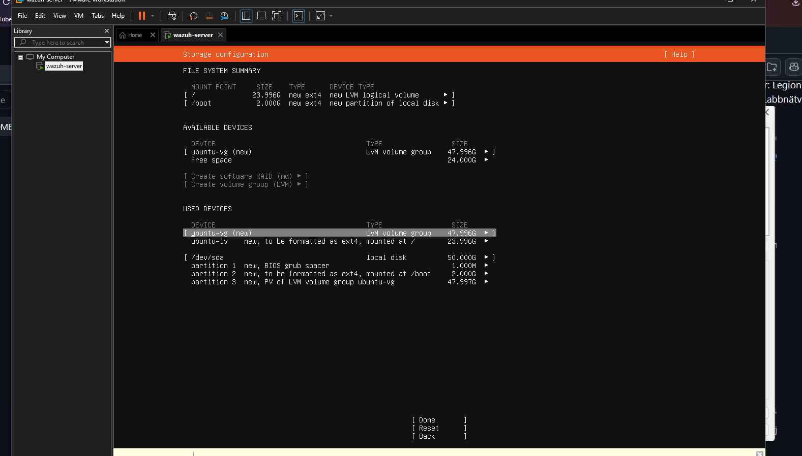
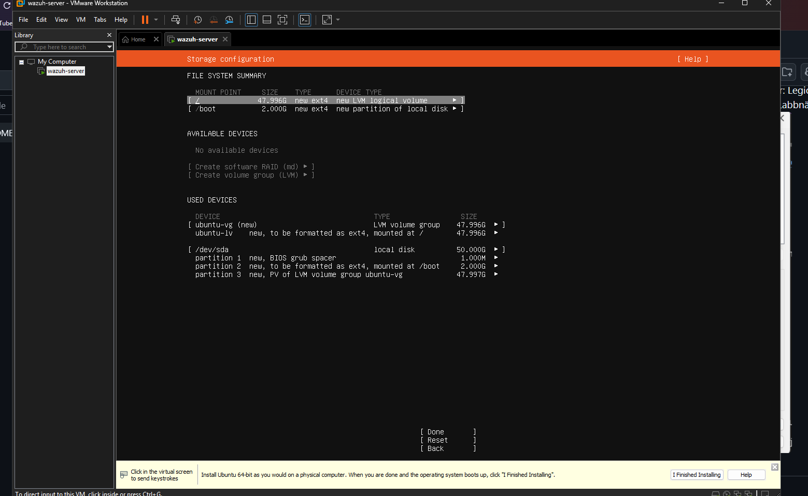
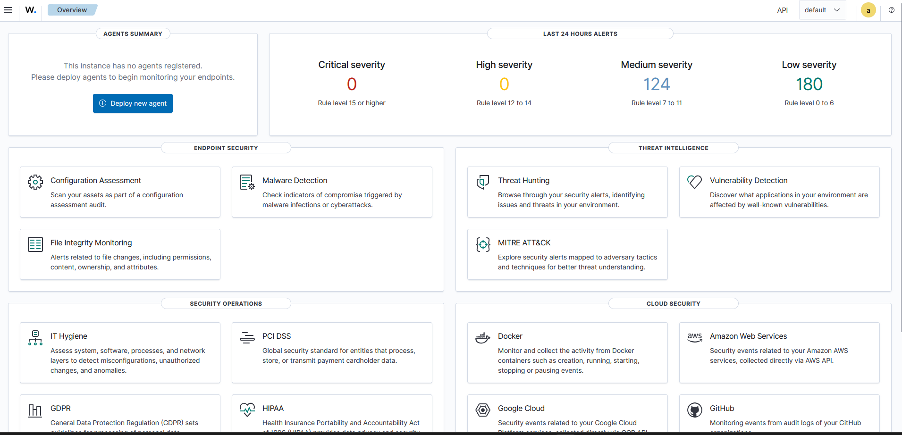

# 01 – Wazuh-servern

## Värd
- Lenovo Legion 7i, 32 GB RAM, VMware Workstation Pro 26.0.1
- Hyper-V/VBS är aktivt → Windows Hypervisor Platform (WHP) slogs på manuellt så att VMware kan köra VM:ar
- Installationsfilen verifierades med SHA256

## VM
| Resurs | Värde |
|---|---|
| OS | Ubuntu Server 24.04 LTS |
| CPU / RAM / Disk | 4 vCPU / 8 GB / 50 GB |
| NIC 1 | NAT – internet för installation |
| NIC 2 | VMnet2 – labbnät, fast IP 10.10.10.10, ingen gateway |

Två nätverkskort: servern når internet utan att labbnätet exponeras. NAT-kortet kan kopplas ur efter installation.

## Installation
```bash
sudo apt update && sudo apt full-upgrade -y
curl -sO https://packages.wazuh.com/4.14/wazuh-install.sh
sudo bash ./wazuh-install.sh -a
sudo sed -i "s/^deb /#deb /" /etc/apt/sources.list.d/wazuh.list   # stoppa oavsiktliga uppgraderingar
```
Dashboard: `https://10.10.10.10`. Snapshot: `wazuh-clean-install`.

## Problem och lösningar
- **Bara halva disken användes:** Ubuntus LVM-standard gav `/` 24 av 48 GB. Utökades till max i installationen.
- **Värden svarar inte på ping från labbnätet:** Windows-brandväggen blockerar. Behålls avsiktligt så att värden skyddas mot Kali.
- **Side channel mitigations:** behålls på (säkerhet före prestanda).

## Skärmdumpar



